# enrutador

[](https://github.com/SamaelFL/enrutador/actions/workflows/pruebas.yml) [](LICENSE)

A Claude Code mod that cuts what long sessions cost. It compacts the session when the context passes 200k tokens, runs subagents on Sonnet, and still sends easy requests to Sonnet when that is cheap. Measured on 275 turns of my own history: **32% less API-equivalent cost**.

[Español abajo](#español)

## The numbers

I built v1 to route easy requests from Opus to Sonnet. Then I measured it on six weeks of my real Claude Code history (37 sessions, 275 turns) with `medir/medir.ts`, the tool in this repo, and it saved **0%**. My sessions are long and run at high effort, so switching models mid-session rewrites a huge prompt cache, which costs more than Sonnet saves. Making the switch more aggressive made it worse (down to −5%).

What actually drove the cost was how much context every step re-reads: in my long sessions, more than 500k tokens per step. So v2 attacks that:

| Change | Saving on my history |
|---|---:|
| Compact the session when the context passes 200k | 30.0% |
| Run subagents on Sonnet (except Plan) | 2.4% |
| **v2, both** | **32.4%** ($512 → $346) |
| v1, model routing in the main session | 0.0% |

API-equivalent cost at list prices. It is a replay of my history, not a benchmark, and subscription limits are not public, so this is not a plan percentage. Run the same measurement on yours (below).

## What it does

- **Compacts between turns.** When a turn ends and the context is over 200k tokens, it compacts the session (the same as `/compact`), keeping the task in progress whole. Claude Code does not allow compacting once a request has arrived, so it happens when the previous turn closes. Start a request with `!sigue` when the next one depends on it, and it will not compact after that turn.
- **Subagents on Sonnet.** Each subagent starts with its own context, so moving it to Sonnet rewrites nobody's cache. Types listed in `subagentesEnOpus` (default `Plan`) stay on Opus. Engine forks with no type are left alone.
- **Model routing in the main session (from v1).** The first request of a task picks the model and effort; Haiku classifies it (~1 s) and, when unsure, moves one level up. Sensitive words, slash commands, attachments, long requests and plan mode go to Opus; with a warm cache it only goes up. It escalates mid-task on 3 errors in a row or when the model calls `subir_nivel`. On my history this part is neutral (0.0%): it does not save and does not cost.

The decision logic is pure functions in `hooks/logica.ts`, tested on their own; `hooks/register.ts` wires them to Claude Code's events.

## Usage

- Prefixes: `!sigue` (do not compact after this turn), `!sonnet`, `!opus`, `!max`.
- `/enrutador` shows the status · `/enrutador on|off` · `/enrutador stats` (compactions, subagent steps on Sonnet, tokens per model) · `/enrutador reset`.

## Measure it on your own history

`medir/medir.ts` replays your Claude Code history (`~/.claude/projects`) and compares the API-equivalent cost of Opus-only against each policy, v2 included, counting cache rewrites, compactions and classifier calls. Requires Node 22.6 or newer. With `ANTHROPIC_API_KEY` it calls the API; without it, it classifies through `claude -p` with your normal Claude Code login (no tools, no hooks, nothing saved to your history).

```bash
cd enrutador
node --experimental-strip-types medir/medir.ts --sin-clasificar   # counts prompts, spends nothing
node --experimental-strip-types medir/medir.ts                    # measures every policy
node --experimental-strip-types medir/medir.ts --tendencias       # context, steps and subagents per week
```

Options: `--desde` / `--hasta` (YYYY-MM-DD), `--excluir <text>` to skip projects. It only sends each prompt and the end of the previous reply to Haiku, the same as the router, and only writes totals to disk.

## Install

Requires Claude Code 2.1.296 or newer.

```
git clone https://github.com/SamaelFL/enrutador.git
cd enrutador
claude plugin marketplace add "$PWD"
claude plugin install enrutador@enrutador
```

After editing the folder, run `/reload-plugins` inside Claude Code.

Settings: `compactarEn` (tokens; 0 turns compaction off; default 200000), `subagentesEnOpus` (comma-separated subagent types that stay on Opus; default `Plan`), `minutosCacheFria` (default 60) and `modeloLigero` (empty means the Opus id with `sonnet` instead of `opus`).

## Uninstall

```
claude plugin uninstall enrutador@enrutador
claude plugin marketplace remove enrutador
```

## License

MIT

---

## Español

Mod para Claude Code que baja lo que cuestan las sesiones largas. Compacta la sesión cuando el contexto pasa de 200k tokens, corre los subagentes en Sonnet y sigue mandando a Sonnet lo fácil cuando sale barato. Medido en 275 turnos de mi propio historial: **32% menos costo equivalente de API**.

### Los números

La v1 mandaba los pedidos fáciles de Opus a Sonnet. Cuando la medí con seis semanas de mi historial real de Claude Code (37 sesiones, 275 turnos) usando `medir/medir.ts`, la herramienta de este repo, ahorraba **0%**. Mis sesiones son largas y van en esfuerzo alto: cambiar de modelo a media sesión reescribe una caché enorme y cuesta más de lo que ahorra Sonnet. Hacerlo más agresivo lo empeoraba (hasta −5%).

Lo que de verdad pesaba era cuánto contexto relee cada paso: en mis sesiones largas, más de 500k tokens por paso. La v2 ataca eso:

| Cambio | Ahorro en mi historial |
|---|---:|
| Compactar la sesión al pasar de 200k de contexto | 30.0% |
| Subagentes en Sonnet (salvo Plan) | 2.4% |
| **v2, las dos** | **32.4%** ($512 → $346) |
| v1, cambiar de modelo en la sesión principal | 0.0% |

Costo equivalente de API a precios de lista. Es una repetición de mi historial, no un benchmark, y los límites de los planes no son públicos, así que no es un porcentaje del plan. Mídelo con el tuyo (abajo).

### Qué hace

- **Compacta entre turnos.** Al terminar un turno con más de 200k tokens de contexto, compacta la sesión (lo mismo que `/compact`) conservando completa la tarea en curso. Claude Code no deja compactar cuando el pedido ya llegó, así que lo hace al cerrar el turno anterior. Si el siguiente pedido depende del actual, empieza el actual con `!sigue` y no compacta al terminarlo.
- **Subagentes en Sonnet.** Cada subagente arranca con su propio contexto, así que pasarlo a Sonnet no reescribe la caché de nadie. Los tipos de `subagentesEnOpus` (por defecto `Plan`) se quedan en Opus. Las bifurcaciones del engine sin tipo no se tocan.
- **Cambio de modelo en la sesión principal (de la v1).** El primer pedido de cada tarea elige modelo y esfuerzo; Haiku lo clasifica (~1 s) y ante la duda sube un nivel. Palabras delicadas, comandos, adjuntos, pedidos largos y el modo plan van en Opus; con la caché caliente solo sube. Escala a medio turno tras 3 errores seguidos o si el modelo llama `subir_nivel`. En mi historial esta parte es neutra (0.0%): ni ahorra ni cuesta.

### Uso

- Prefijos: `!sigue` (no compactar al terminar este turno), `!sonnet`, `!opus`, `!max`.
- `/enrutador` estado · `/enrutador on|off` · `/enrutador stats` (compactaciones, pasos de subagentes en Sonnet, tokens por modelo) · `/enrutador reset`.

### Mídelo con tu historial

`medir/medir.ts` repite tu historial de Claude Code (`~/.claude/projects`) y compara el costo equivalente de API de solo Opus contra cada política, la v2 incluida, contando la caché reescrita, las compactaciones y el clasificador. Necesita Node 22.6 o más nuevo. Con `ANTHROPIC_API_KEY` llama a la API; sin ella, clasifica con `claude -p` y tu sesión normal de Claude Code (sin herramientas, sin hooks y sin guardar nada en tu historial).

```bash
cd enrutador
node --experimental-strip-types medir/medir.ts --sin-clasificar   # cuenta los pedidos, no gasta nada
node --experimental-strip-types medir/medir.ts                    # mide todas las políticas
node --experimental-strip-types medir/medir.ts --tendencias       # contexto, pasos y subagentes por semana
```

Opciones: `--desde` / `--hasta` (AAAA-MM-DD), `--excluir <texto>` para saltar proyectos. Solo manda a Haiku el pedido y el final de la respuesta anterior, igual que el enrutador, y en disco solo guarda totales.

### Instalar

```
git clone https://github.com/SamaelFL/enrutador.git
cd enrutador
claude plugin marketplace add "$PWD"
claude plugin install enrutador@enrutador
```

Ajustes: `compactarEn` (tokens; 0 apaga la compactación; por defecto 200000), `subagentesEnOpus` (tipos de subagente separados por coma que se quedan en Opus; por defecto `Plan`), `minutosCacheFria` (60) y `modeloLigero`.

### Quitar

```
claude plugin uninstall enrutador@enrutador
claude plugin marketplace remove enrutador
```
